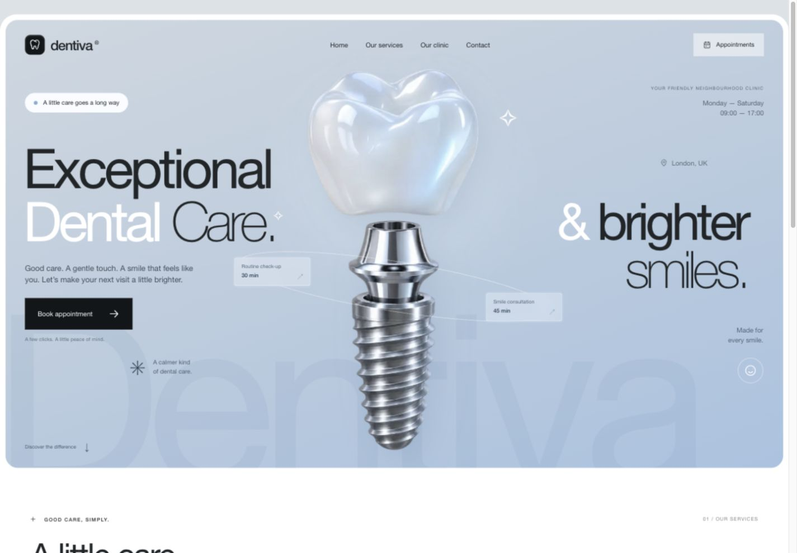

# Dentiva — dental-clinic WebMCP starter

A Next.js appointment-booking demo for Skillbum's WebMCP learning path. The icy-blue layout, oversized type and floating tooth artwork follow the owner's supplied design reference. This is a fictional clinic: use sample patient details. No real appointments, payments or emails are sent.

This is the **before-WebMCP** version. Learners first ask a browser-capable AI tool to book through the normal interface, then add WebMCP and compare the two interaction paths. WebMCP is deliberately not registered in this starter.

## Run locally

Requires **Node.js 24** and npm. No environment variables, API keys, external database or clinic account are needed to run the app. Model access and browser-control setup for an AI tool are separate.

Clone this repository and start the app:

```sh
git clone https://github.com/UnnikrishnanBhargavakurup/dentiva-webmcp-starter.git
cd dentiva-webmcp-starter
npm install
npm run dev
```

Open [http://127.0.0.1:3100](http://127.0.0.1:3100). The default server binds only to your computer. If port 3100 is occupied, stop the other process or change the port in `package.json`.

This repository is a standalone instructional app with its own dependencies and lockfile. You do not need the Skillbum monorepo. Start with this ordinary-browser version; WebMCP is the change you will build during the learning path.



[Preview the booking form](assets/previews/booking-desktop.jpg)

## Try a booking

1. Choose **Book appointment**, or a service card's arrow.
2. Select the visit, an enabled calendar day and an available slot.
3. Continue, enter fictional details such as **Alex Taylor / alex@example.com**, and review the appointment.
4. Confirm the demo appointment. The success screen displays the saved reference and details.
5. Open **Appointments** to see the booking after a page reload. Its occupied time is removed from availability, including overlapping appointments of different durations.
6. For another practice run, choose **Reset demo data** in Appointments and confirm the local reset.

The clinic uses **London time**, Monday–Saturday, 09:00–17:00, with a 12:30–13:30 break. Dates are available up to 28 days ahead. One shared simulated dentist handles all visits: check-up (30 minutes), clean & polish (60 minutes), consultation (45 minutes).

## Local persistence

Appointments are stored in the ignored `.data/dentiva.sqlite` file using Node's built-in SQLite API. Data survives browser reloads and server restarts. This is one shared local practice calendar, not private patient accounts. Use fictional data only. Node may print an experimental SQLite notice; no separate database installation is required.

Booking checks and writes share one SQLite transaction. Overlapping slots are rejected, and retrying the same operation ID with the same normalized details returns the original appointment. A timed-out browser save stays unconfirmed until the same request succeeds on retry. Resetting the demo intentionally clears bookings and retry records.

## Where to learn and edit

| File | Role |
| --- | --- |
| `components/clinic-website.tsx` | Landing page and entry buttons |
| `components/booking-dialog.tsx` | Visit/time selection, patient form, confirmation and retry key |
| `components/calendar.tsx` | Accessible calendar and selectable dates |
| `lib/clinic.ts` | Services, timezone and scheduling rules shared by the UI/server |
| `lib/booking-store.ts` | Shared availability/booking operations and SQLite persistence |
| `app/api/availability/route.ts` | Available slots for a visit/date |
| `app/api/appointments/route.ts` | List and create demo appointments |
| `app/api/reset/route.ts` | Reset the local practice calendar |
| `app/globals.css` | Responsive reference-style design |

A future WebMCP adapter should call the same booking operations through the existing application boundary. Preserve validation, slot checks, local persistence and the agreed review/confirmation behavior. Do not add a second booking implementation or write directly to the database from a browser tool.

Potential teaching tools are `get_available_slots` and `book_appointment`; their exact schemas and declarative/imperative route are still to be authored and tested. Adding metadata alone does not implement booking behavior.

## Checks

```sh
npm test          # Booking, persistence, retry, overlap, date and origin checks
npm run check    # TypeScript
npm run build    # Next.js production build
npm start        # Serve the production build locally on port 3100
```

See [verification notes](VERIFICATION.md) for the actual browser checks and their limits. Dependency versions are pinned: Next.js 16.4.6, React/React DOM 19.3.1 and TypeScript 5.9.3. Use `npm ci` for subsequent reproducible installs.

## Design and scope

The owner's uploaded screenshot supersedes the earlier Pinterest search. The site uses original generated tooth artwork, local system fonts and original UI code; it does not embed the reference screenshot or third-party Pinterest assets. Artwork provenance and its Imagegen prompt are in [assets/hero-artwork.md](assets/hero-artwork.md).

This is a local learning demo, not a production clinic service. It does not connect to Skillbum learner records or a real dental practice. The actual same-agent before/after WebMCP benchmark remains unrun.
